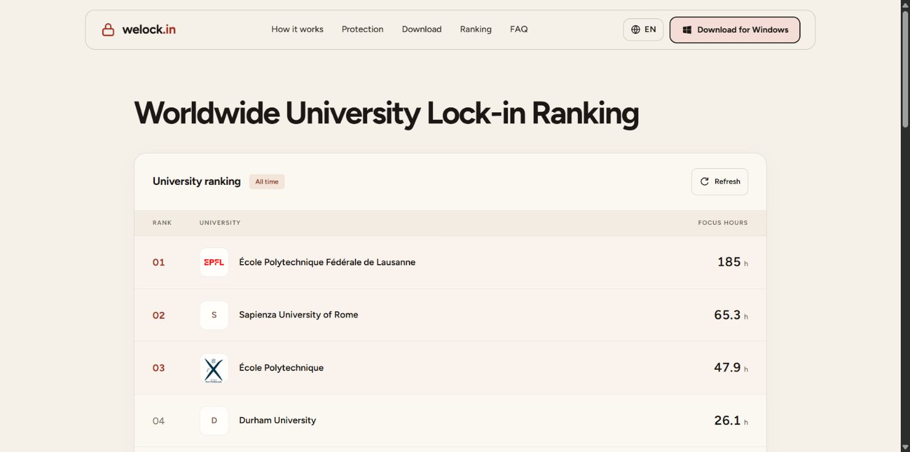

# Building Welockin’s university focus leaderboard

*13 November 2026 · Product and engineering notes by Hedi Fourati*

We just added a university leaderboard to [Welockin](https://www.welock.in/ranking), the distraction-blocking app my team and I build.

The idea is simple: students’ focus hours add to their university’s total. Get a few people from your course together, start a study session, and help your university move up the table.

Making that public involved more than sorting some numbers. We had to decide what a total means, which information belongs on the public page, and how to keep the page quick to load.

*This is a real production screenshot. The totals change as sessions are recorded.*

## What the ranking measures

The first version is all-time. It adds up the focus time recorded by participating users, grouped by the higher-education institution attached to their profile.

For a simple example, three classmates who each record a one-hour session contribute three hours to their university’s total.

This measures participation in Welockin. It does not measure academic quality or learning outcomes. A larger group can contribute more hours, so a total-hours leaderboard naturally favors universities with more participating students.

There are also measurement limits. Recent session records carry measured durations, while older records can use estimates. Sessions recorded on different devices can overlap, and historical sessions are associated with the user’s current university. The total is therefore a useful group activity indicator, not a precise count of unique human study hours.

A weekly view or a total per active student would answer a different question. We started with one public view so its meaning stays clear.

## Publish the aggregate, keep student profiles out

The public table contains the university’s rank, name, logo where available, and combined hours. It does not show student names, emails, profiles, or individual session details.

We build the public response around those allowed fields. That is a stronger boundary than sending individual records to the browser and hiding their columns in the interface.

There is no separate leaderboard for individual students on this page. The invitation is to contribute to your university together.

## A five-minute cache is enough for this page

A study leaderboard does not need a live connection for every visitor. We allow updates to take up to five minutes and make that delay visible on the page.

The backend caches the result, and concurrent requests can share the same computation. That avoids repeating the aggregation for every page refresh. A refresh button remains useful without implying that each click forces a fresh database scan.

One design rule matters here: if the service cannot produce a complete result within its limits, it should show an unavailable state instead of presenting partial totals as a complete ranking.

This is an initial implementation. As usage grows, maintained aggregates are the next step to evaluate; we are not claiming unlimited capacity from a cached first version.

## Institution names are data, not decoration

People can refer to the same school by its full name, an acronym, or an older name. We use institution identities and reviewed aliases rather than treating every spelling as a different university.

The ranking includes higher-education student profiles linked to a recognised institution in our catalogue: universities, grandes écoles, institutes and French preparatory classes (CPGE). Secondary-school and work profiles are excluded. An institution’s presence in the catalogue alone does not make every profile attached to it eligible.

The page includes a form to request a missing institution. Requests go into an admin review queue; submitting one does not automatically publish a new school or create another entry for an existing identity.

## Design for incomplete assets and large numbers

Not every institution has a verified logo. When one is missing, we show a letter alongside the institution’s name, so a broken image does not leave a blank row.

Long names need room to wrap. The hours column needs to remain readable as the number grows. We tested layouts with very short and very long names, missing logos, and totals up to one million hours.

Those large numbers were layout fixtures, not current usage figures or evidence that the backend handles a million hours at any traffic level. Keeping test data separate from production screenshots matters when sharing progress publicly.

## What we want to learn next

The feature is live. The question now is whether a shared university total gives classmates a useful reason to start a session together. We do not yet have evidence that it increases study time or improves results.

If you are at university, choose your institution in the app and try your next session with a few coursemates. You can see the totals on the [live ranking](https://www.welock.in/ranking), or [view the page in French](https://www.welock.in/fr/ranking).

Would a weekly reset make this more useful for your study group, or would you prefer to keep building an all-time total?

---

*Affiliation: I am one of Welockin’s creators. This article was prepared with AI assistance from our implementation notes and checked against the shipped feature.*

*Update — 13 November 2026: CPGE are now included in the ranking for eligible higher-education student profiles. The earlier version of this article stated that they were excluded.*
